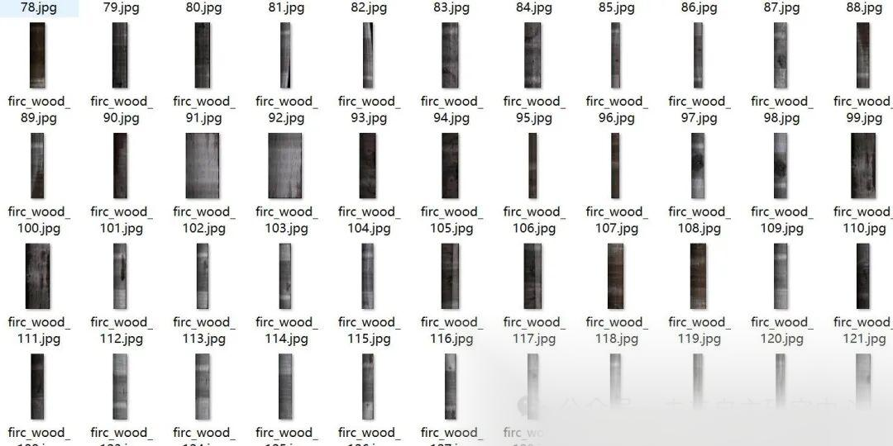
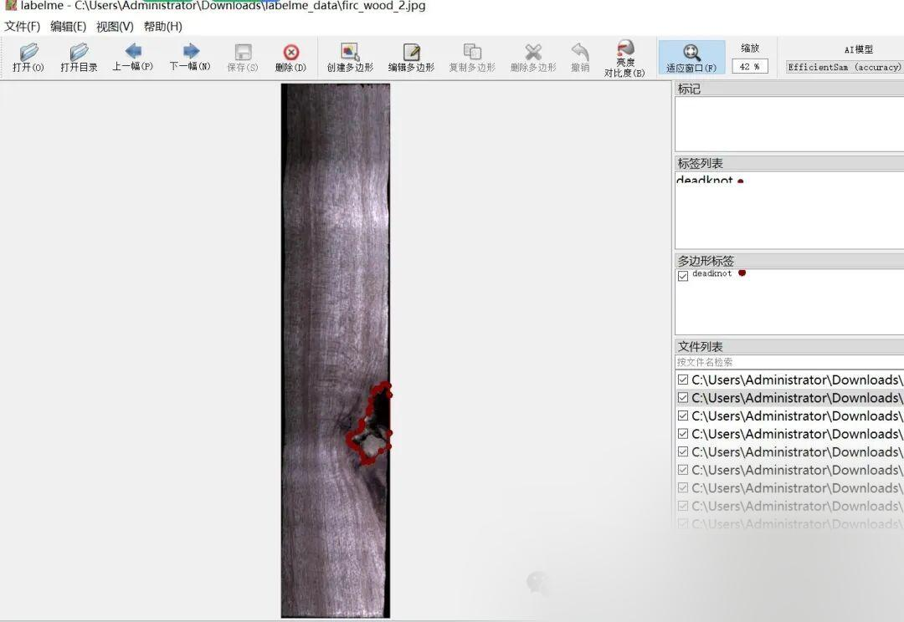

# Wood Defects Segmentation Dataset - labelme format with 1548 images in 4 categories

Important Notice: The images are all quite long, they are vertically oriented and the backgrounds are dark. Please refer to the image preview for details.

Dataset format: labelme format (without mask files, only including jpg images and corresponding json files)

Number of images (number of jpg files): 1548

Number of annotations (number of json files): 1548

Labeling category count: 4

Annotation Category Names: ["deadknot", "pinhole", "undersized", "crack"]

Number of boxes labeled in each category:

deadknot count = 837

pinhole count = 1124

undersized count = 815

crack count = 1161

Using labeling tool: labelme=5.5.0

Annotation rules: Draw polygons around the categories.

Important Notice: The dataset can be opened and edited using LabelMe. For JSON datasets, one must convert them into mask or Yolo formats for semantic segmentation or instance segmentation.

Special : This dataset does not guarantee the accuracy or precision of the trained models or weight files. The dataset is provided with accurate and reasonable annotations only.

Image Preview:

Annotation example:

## Payment

Here is a pay link on Stripe ( https://buy.stripe.com/3cs8yP7sY87d0vu9AB ). Please contact me lonlonago@foxmail.com after funding $89, and I will send you a complete data files , thank you!

